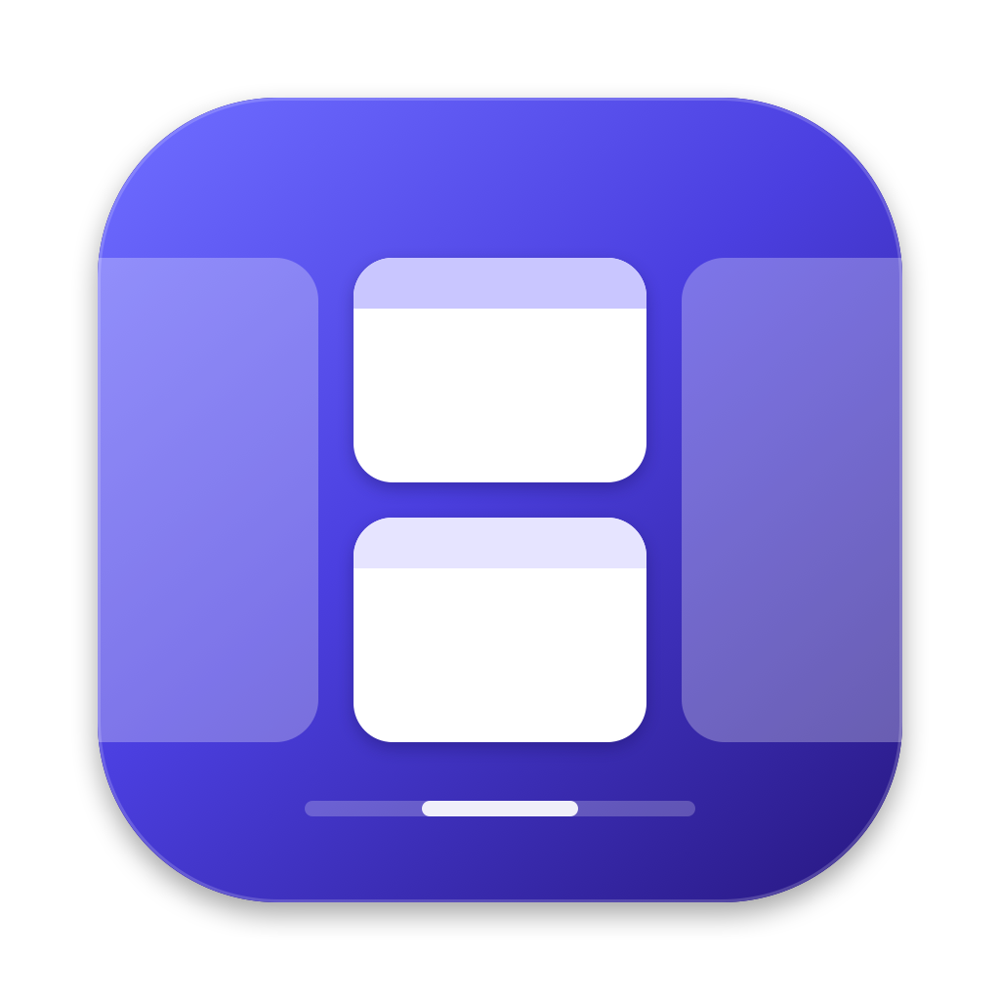
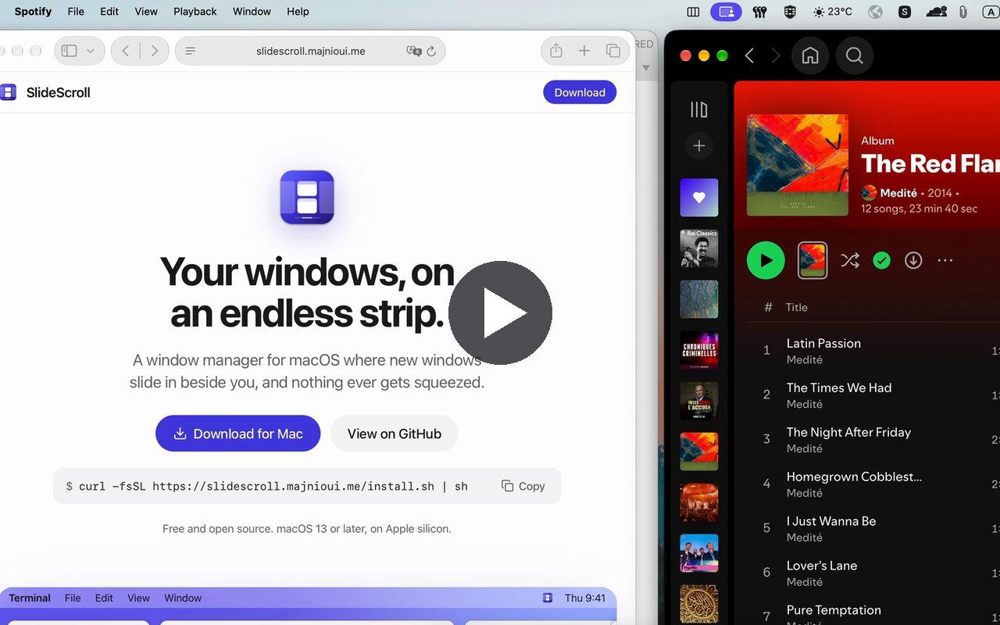

<div align="center">



# SlideScroll

**A scrolling window manager for macOS.**<br>
Your windows live on an endless horizontal strip. Opening one never squeezes the others.

[](https://github.com/majnioui/SlideScroll/releases/latest)
[](https://github.com/majnioui/SlideScroll/actions/workflows/release.yml)
[](#requirements)
[](#requirements)
[](LICENSE)

[**Download**](https://github.com/majnioui/SlideScroll/releases/latest) ·
[Features](#features) ·
[Setup](#first-launch) ·
[Shortcuts](#shortcuts) ·
[FAQ](#troubleshooting--faq) ·
[Roadmap](#roadmap)

<br>

<a href="https://youtu.be/iG9rnbIasas"></a>

<sub><a href="https://youtu.be/iG9rnbIasas">▶ Watch the demo on YouTube</a> (34 seconds)</sub>

</div>

---

Tiling window managers split your screen into ever-smaller tiles. SlideScroll does
the opposite: every window is a **column** on a strip that runs past the edges of
the screen, at the width *you* chose. Open a window and it slides in beside the one
you're using; nothing else changes size. Swipe with four fingers or press a
shortcut to scroll the strip, the way [niri](https://github.com/YaLTeR/niri) and
[PaperWM](https://github.com/paperwm/PaperWM) work on Linux.

SlideScroll is free, open source, and a native Mac app, with no Electron, no web
views and no account. Its only network access is
checking GitHub for updates, which Settings can turn off.

## Features

- **Scrolling strip.** Columns keep their width. Scroll by trackpad swipe (1:1 with
  your fingers, then it snaps to a column), by shortcut, or by clicking or
  Cmd-Tabbing to a window.
- **Widths that make sense.** Cycle through ¼, ⅓, ½, ⅔, ¾ of the screen, go full
  width and back, centre a column, or nudge it wider and narrower.
- **Stacks.** Put several windows in one column, one above the other. Drag a window
  onto another to stack it, drag the edge between them to share the height, or
  pop it back out.
- **Tabs.** Turn a stack into a tabbed column with a clickable tab bar. Native macOS
  tabs (Finder, Terminal, Ghostty, …) stay in their column too.
- **Pinning.** Keep a column at the left or right edge while the rest scrolls past.
- **Multiple displays.** Each display has its own strip. Send windows between
  displays with a shortcut or by dragging, and nothing spills onto the
  neighbouring screen.
- **Plays well with macOS.** Ignores full-screen apps and other Spaces, floats
  dialogs and fixed-size windows, survives sleep, locking and displays coming and
  going, and remembers your layout across restarts.
- **Every shortcut is yours.** Remap any action in Settings, with two shortcuts per
  action. Works on any keyboard layout.
- **Safe.** Quitting, pausing or even a crash puts every window back on screen.
- **Tells you what's wrong.** Settings → General checks for macOS settings that
  get in the way, live, and one click opens the right System Settings pane.

## Requirements

- macOS 13 Ventura or later
- A Mac with Apple silicon (M1 or later)
- A built-in trackpad or Magic Trackpad for swipes (everything else works with a
  keyboard and mouse)

## Install

Paste this into Terminal. It downloads the latest release, checks it against
the release's checksums, puts SlideScroll in Applications and opens it; run it
again to update. It's [`site/install.sh`](site/install.sh) if you'd like to read it first.

```sh
curl -fsSL https://slidescroll.majnioui.me/install.sh | sh
```

Or install the disk image by hand:

1. Download `SlideScroll-<version>.dmg` from the
   [latest release](https://github.com/majnioui/SlideScroll/releases/latest).
2. Open it and drag **SlideScroll** into **Applications**.
3. Open SlideScroll from Applications.

> [!NOTE]
> The disk image isn't notarized yet (the Terminal install above avoids this).
> macOS says it "could not verify" SlideScroll the
> first time you open it. Click **Done**, then go to **System Settings → Privacy &
> Security**, scroll down to *"SlideScroll" was blocked* and click **Open Anyway**.
> Or run `xattr -dr com.apple.quarantine /Applications/SlideScroll.app` once.

Or build it from source with [Homebrew](https://brew.sh) (it builds with the Swift
that comes with the Xcode Command Line Tools):

```sh
brew tap majnioui/slidescroll https://github.com/majnioui/SlideScroll
brew install slidescroll
```

Homebrew prints how to link it into Applications. Update with
`brew upgrade slidescroll`; each build has a new signature, so allow
Accessibility again afterwards.

## Updates

SlideScroll checks for a new release shortly after it starts and every six
hours. When there is one, it downloads it in the background, checks it against
the release's checksums, and offers **Restart to Update** in its menu and in
**Settings → General**. Restarting puts every window back on screen, swaps in the
new version and opens it. Turn the checks off, or check now, in Settings → General.

Releases are signed with the same certificate, so updates keep the
Accessibility permission. Builds signed ad hoc (your own, or Homebrew's) need it
again after each update: SlideScroll clears the old build's entry from the list by
itself, so just turn **SlideScroll** on again when macOS asks.

## First launch

SlideScroll moves other apps' windows, which needs the **Accessibility** permission.
On first launch macOS asks for it: open *System Settings → Privacy & Security →
Accessibility*, turn on **SlideScroll**, and it starts right away. No restart, and
no other permissions: no Screen Recording, no Input Monitoring, no disabling SIP.

SlideScroll lives in the menu bar, as an icon of three columns side by side. Its
menu has *Pause*, *Settings…* and *Quit*. To start it with your Mac, turn on
**Launch SlideScroll at login** in Settings → General.

### Recommended macOS settings

A few macOS features fight over the same gestures and windows. SlideScroll checks
them in **Settings → General** and lists any problem there, with a button to the
System Settings pane that fixes it. It never changes a macOS setting itself.

| Setting | Where | Set it to | Why |
|---|---|---|---|
| Swipe between full-screen applications | Trackpad → More Gestures | **Off** | SlideScroll scrolls with four fingers. macOS often keeps acting on four fingers even when this shows "three", and a fast four-finger swipe lands as three first. Switch desktops with ⌃← / ⌃→ or Mission Control |
| Drag windows to screen edges to tile | Desktop & Dock → Windows | **Off** | macOS snaps dropped windows into tiles |
| Drag windows to menu bar to fill screen | Desktop & Dock → Windows | **Off** | same |
| Hold ⌥ key while dragging windows to tile | Desktop & Dock → Windows | **Off** | same |
| Stage Manager | Desktop & Dock | **Off** | it moves and resizes windows too |
| Other window managers | Rectangle, Magnet, Loop, Moom, … | **Quit them** | two apps moving the same windows |

If macOS still switches desktops after you turn the swipe off, log out and back
in: trackpad changes sometimes only apply then.

<details>
<summary>Prefer three-finger swipes?</summary>

Set *Swipe between full-screen apps* to **four fingers** and *Swipe between pages*
to **two fingers**, turn off **Three Finger Drag** (Accessibility → Pointer Control
→ Trackpad Options), and choose **Three fingers** in SlideScroll's
**Settings… → Windows**.

</details>

## Using SlideScroll

**The strip.** Each window is a column. The focused column is always fully on
screen; columns past the edges wait just off screen, with a sliver showing. Focus
a column and the strip scrolls just far enough to show it.

**Swiping.** Four fingers left or right drag the strip under your fingers. Let go
and it glides to the nearest column. On multiple displays, the swipe scrolls the
display under the pointer. **Settings… → Windows** switches to three fingers or
reverses the direction.

**Several displays.** Each display has its own strip. Focusing left or right past
the end of one strip carries on to the nearest column of the display beside it.

**Dragging with the mouse.**
- Drag a window by its title bar and drop it between two columns to **reorder**.
- Drop it with the pointer over the **bottom quarter** of another window to stack
  it **below**, or the **top quarter** (just under the title bar) to stack it
  **above**. A highlight shows where it will land.
- Drop it on another display to move it to that display's strip.
- Resize a window's **side** to set its column's width. Resize the **edge between
  two stacked windows** to share the height. A lone window keeps the height you give it.

**Floating.** Dialogs, panels and windows that can't be resized float above the
strip on their own. Press `⌃⌥T` to float or unfloat any window.

**Pausing.** *Pause* in the menu bar brings every window on screen and leaves them
alone, with your shortcuts going to apps as usual, until you *Resume*.

## Shortcuts

All shortcuts use **⌃ Control + ⌥ Option** by default, so plain ⌥ stays free for
typing accented characters. Every one can be changed: see [Customising](#customising).

| Action | Shortcut |
|---|---|
| Focus left / right | `⌃⌥H` `⌃⌥L` or `⌃⌥←` `⌃⌥→` |
| Focus up / down in a stack | `⌃⌥K` `⌃⌥J` or `⌃⌥↑` `⌃⌥↓` |
| Focus first / last window | `⌃⌥⌘←` / `⌃⌥⌘→` |
| Jump to window 1–9 | `⌃⌥1` … `⌃⌥9` |
| Focus next display | `⌃⌥N` |
| Move column left / right | `⌃⌥⇧H` `⌃⌥⇧L` or `⌃⌥⇧←` `⌃⌥⇧→` |
| Move window up / down in a stack | `⌃⌥⇧K` `⌃⌥⇧J` or `⌃⌥⇧↑` `⌃⌥⇧↓` |
| Move window to next display | `⌃⌥⇧N` |
| Pin column to left / right edge (again to unpin) | `⌃⌥P` / `⌃⌥⇧P` |
| Float / unfloat window | `⌃⌥T` |
| Cycle width (¼, ⅓, ½, ⅔, ¾) | `⌃⌥R` |
| Full width (again to restore) | `⌃⌥F` |
| Centre column | `⌃⌥C` |
| Wider / narrower | `⌃⌥=` / `⌃⌥-` |
| Taller / shorter in a stack | `⌃⌥⇧=` / `⌃⌥⇧-` |
| Equal heights (a lone window gets full height back) | `⌃⌥0` |
| Stack into left / right column | `⌃⌥[` / `⌃⌥]` |
| Pop out of stack to the left / right | `⌃⌥⇧[` / `⌃⌥⇧]` |
| Tabbed column on / off | `⌃⌥⇧T` |
| Quit (puts every window back on screen) | `⌃⌥Q` |
| Scroll the strip | four-finger swipe ← → |

Shortcuts and swipes do nothing in full-screen apps and on Spaces SlideScroll
isn't managing, so they never scroll the strip behind your back.

## Customising

**Settings… → Windows** chooses the swipe (three or four fingers, natural or
reversed direction), the space between windows, and apps whose windows always
float: they stay where you put them, outside the strip.

Open **Settings…** from the menu bar and pick the **Shortcuts** tab. Click any
shortcut and press the new keys;
each action has two slots. Esc cancels, Delete removes the shortcut, ↺ puts an
action's defaults back. If a shortcut is already taken, it moves to the action you
just set. Shortcuts need ⌃, ⌥ or ⌘, so they can't take over typing.

Shortcuts are stored by **physical key**, so they keep working when you switch
keyboard layouts, and Settings labels them the way *your* keyboard does (on AZERTY
you'll see `⌃⌥A` where QWERTY shows `⌃⌥Q`).

Settings are saved to `~/Library/Application Support/slidescroll/config.toml`,
which you can also edit by hand. It only lists what you've changed:

```toml
[keys]
focus_left = ["ctrl+alt+j", "ctrl+alt+left"]
cycle_width = ["ctrl+cmd+w"]
quit = []    # no shortcut

[swipe]
fingers = 3       # 3 or 4
natural = false   # reverse the direction

[layout]
gap = 12.0        # points between windows, 0 to 32

[apps]
float = ["Calculator", "System Settings"]
```

## Troubleshooting & FAQ

<details>
<summary><b>Swiping switches desktops instead of scrolling the strip</b></summary>

macOS also uses four-finger swipes for *Swipe between full-screen apps*. Set it to
three fingers in *System Settings → Trackpad → More Gestures* (SlideScroll's menu
warns about this and opens the pane for you). If a change doesn't take effect, log
out and back in.
</details>

<details>
<summary><b>Nothing moves / the menu says it's waiting for permission</b></summary>

Open *System Settings → Privacy & Security → Accessibility* and make sure
SlideScroll is on. After an update or a reinstall, SlideScroll removes the entry
the previous build left there and asks again, so the switch you see is for the
build you're running. If it's on and SlideScroll still waits, remove it with
**–**, add it again from Applications, and relaunch.
</details>

<details>
<summary><b>A window jumps when I drop it near the edge of the screen</b></summary>

That's macOS window tiling snapping it into place before SlideScroll puts it back.
Turn off the three tiling options in *Desktop & Dock → Windows*.
</details>

<details>
<summary><b>Shortcuts don't work</b></summary>

Check SlideScroll isn't paused (its menu bar icon is dimmed when it is), and that
another app hasn't claimed the same keys. You can change any shortcut in
**Settings…**.
</details>

<details>
<summary><b>Does it work with Spaces and full-screen apps?</b></summary>

Yes. SlideScroll manages the Space you start it on and leaves full-screen apps and
other Spaces alone; switching back picks up where you left off. One strip per Space
is on the [roadmap](#roadmap).
</details>

<details>
<summary><b>What happens to my windows if I quit?</b></summary>

Quitting (from the menu, `⌃⌥Q`, logging out or shutting down) brings every window
back on screen first. So does pausing, and so does a crash.
</details>

<details>
<summary><b>Reporting a bug</b></summary>

Turn on **Verbose logging** in Settings → General, reproduce the problem, then
click **Show Log in Finder** and attach `slidescroll.log` to a
[new issue](https://github.com/majnioui/SlideScroll/issues/new), with your macOS
version and what you expected to happen.
</details>

## Privacy

SlideScroll's only network access is checking GitHub for a new release, which
Settings → General can turn off: no telemetry, no analytics, no account. It doesn't read what's in your windows or record your screen;
it only asks macOS where windows are and moves them. Your layout, settings and log
stay in your home folder.

## How it works

<details>
<summary>Architecture notes</summary>

- **Layout** (`Sources/SlideScrollCore`): the strip as a Swift value type with no
  macOS code, checked by `swift run core-checks`. Columns have a width; the
  viewport looks at the strip from `scroll`. Focusing a column scrolls just far
  enough to show it.
- **Off-screen windows**: macOS won't place a window fully off screen, so columns
  outside the viewport are *parked* against the nearest edge with 8 pt peeking out.
  On a side with another display, they park below the bottom edge instead, so they
  don't spill onto the neighbour.
- **Stacks and tabs**: a column can hold several windows, splitting its height by
  weights, or showing them as tabs under a frosted bar drawn in a non-activating
  panel, so clicking a tab never steals focus.
- **Displays**: one strip per display. Strips follow displays being added, removed
  or rearranged; a display that's unplugged and plugged back in gets its columns back.
- **Moving windows**: the Accessibility API (`AXUIElement`). `AXEnhancedUserInterface`
  is switched off only while a window is being moved, so apps don't animate on top
  of SlideScroll and screen readers keep working.
- **Events**: an `AXObserver` per app reports windows opening, closing, moving and
  focus changes. Moves made with the mouse button held are the user's own drags.
- **Animation**: each window follows a critically damped spring, stepped once per
  frame the display shows (`CADisplayLink`, macOS 14+). Moves, resizes and focus
  changes go to a queue per app that keeps only the latest request, so a slow app
  (Electron, Chrome) drops its own frames without slowing the others.
- **Swipes**: raw finger positions from Apple's private `MultitouchSupport`
  framework, loaded with `dlopen`.
- **Shortcuts**: a `CGEventTap` swallows key presses that match the keymap and sends
  commands to the engine.
- **App**: the engine runs on a serial queue of its own and never touches AppKit;
  the main thread has the menu bar item, the SwiftUI Settings window, the tab bars,
  and sleep, lock and display notifications.
- **Resilience**: the engine suspends while the Mac sleeps or is locked and re-syncs
  on wake, and puts every window back on screen when it quits.
- **Spaces**: when none of a strip's windows is on screen (another Space or a
  full-screen app), that strip pauses instead of treating them as closed.

</details>

## Building from source

You need macOS 13 or later and Swift 5.10 or later (Xcode, or just the Xcode
Command Line Tools).

```sh
git clone https://github.com/majnioui/SlideScroll.git
cd SlideScroll
swift run core-checks                  # checks for the layout model
scripts/bundle.sh                      # builds build/SlideScroll.app
open build/SlideScroll.app
```

Local builds are signed ad hoc, and macOS ties the Accessibility permission to the
signature: after rebuilding, remove SlideScroll from the Accessibility list and
allow it again. `SIGN_IDENTITY="Developer ID Application: …" scripts/bundle.sh`
signs with your own certificate.

To run without a bundle (the permission then goes to your terminal app):

```sh
swift build -c release
.build/release/slidescroll --list              # read-only: what it sees, moves nothing
SLIDESCROLL_DEBUG=1 .build/release/slidescroll
```

Everything is logged to `~/Library/Logs/SlideScroll/slidescroll.log`, and to the
terminal when there is one. `scripts/make-icon.sh` redraws the app icon from
`scripts/icon.swift`.

## Releasing

Bump `VERSION`, add the release to `CHANGELOG.md`, commit, and check that
[CI](.github/workflows/ci.yml) is green on `main`. Then push a matching tag:

```sh
git tag v0.1.1 && git push origin v0.1.1
```

The [Release workflow](.github/workflows/release.yml) runs the checks, builds the
app and publishes **SlideScroll 0.1.1** with a disk image, a zip and checksums.
`scripts/package.sh` makes the same files locally in `build/dist`. Builds are
signed ad hoc unless the signing secrets listed in the workflow are set.

**Signing.** Without signing secrets, releases are signed ad hoc and users
allow Accessibility again after each update. `scripts/make-signing-cert.sh`
makes a free self-signed certificate and prints the three secrets to add;
releases signed with it keep the permission across updates. A Developer ID in
the same secrets, plus the notarization ones, also removes macOS's first-launch
warning.

## Roadmap

Done:

- [x] Auto-updates, signed with a fixed certificate so updates keep the
      Accessibility permission
- [x] Homebrew formula that builds from source
- [x] Focus crosses displays: `⌃⌥→` on the last column moves to the next display
- [x] Settings for the swipe (fingers, direction), the gap between windows, and
      apps that always float
- [x] Setup checks in Settings that update as you fix them
- [x] Animation timed to the display's refresh, with resizes that never stall it

Planned:

- [ ] Notarized builds and an official Homebrew cask (need a paid Developer ID)
- [ ] One strip per Space; carry a window to another Space
- [ ] Leave chosen displays (presentation, portrait) unmanaged
- [ ] Overview: zoom out to the whole strip, click a window to jump to it
- [ ] Strip indicator: app icons while navigating, click to jump, drag to reorder
- [ ] Focus border, dim unfocused windows
- [ ] Centre modes (never / on overflow / always), focus follows mouse, mouse
      follows focus
- [ ] Preset heights in a stack (⅓ / ½ / ⅔), expand a column to fill the empty
      space beside it
- [ ] Scratch layer: one key shows or hides all floating windows
- [ ] Per-app rules: open in a fixed slot or at a set width
- [ ] Keep a window's own height instead of filling the column
- [ ] Guided first run
- [ ] CLI, URL scheme, Raycast commands

## Contributing

Bug reports, ideas and pull requests are welcome. For anything bigger than a small
fix, please [open an issue](https://github.com/majnioui/SlideScroll/issues) first
so we can agree on the approach. Layout logic belongs in `SlideScrollCore` with a
check in `Sources/CoreChecks`; run `swift run core-checks` before sending a pull
request.

## License

[MIT](LICENSE) © 2026 majnioui
